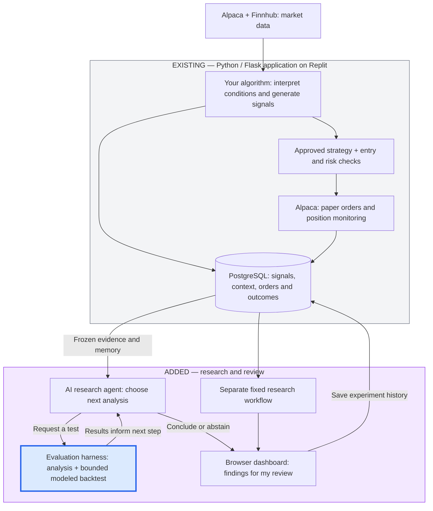

# From an algorithmic trading app to AI-assisted research

**Product + Engineer · Fintech · Agent architecture · Evals · Human control**

## Problem discovery: my own trading workflow

I investigated my own problem: trading required attention while I was away from my laptop, and reviewing results did not provide a repeatable way to decide which changes deserved testing. This began with firsthand use of my application, followed by inspection of its recorded signals, paper fills and research traces—not external customer interviews.

I chose SPY for its high volume and access to low-cost options contracts. Recorded evidence taught me that an apparently useful pattern could be misleading: in Run #47, a market-condition comparison reversed when the agent compared trade directions. Missing historical version tags also meant past outcomes could not reliably describe today's strategy.

## Why this case study

An existing trading application offered a concrete setting to explore **agent autonomy, measurable outcomes and human control**. I could examine the full path from evidence to recommendation, then test where AI should have discretion and where deterministic checks and approval should govern action.

The initial goal is usefulness and reliability in my personal workflow. Broader use would follow controlled live validation and the requirements for wider adoption; external adoption is not claimed today.

## My ownership and product decisions

I owned **problem framing, scope, architecture, AI-assisted coding, integration, evaluation requirements and acceptance**. Development began in **Bolt** and continued in **Replit**.

| Insight from the investigation | Product decision |
|---|---|
| Aggregate outcomes can hide differences in trade mix | Let the agent choose follow-up analyses; compute results deterministically. |
| Historical outcomes lack complete version attribution | Version strategies and evidence; block unsupported baseline claims. |
| A newer model is not evidence of better trading research | Compare frozen proposals against existing strategies under matched evaluation conditions. |
| Trading actions have greater consequences than research | Separate research from execution; retain human approval for live release. |

## 1. Existing: my algorithmic trading application

A **Python/Flask server**, browser dashboard, PostgreSQL database and background workers already supported the trading journey:

**Market data → my algorithm → candidate signals → approved-strategy and risk checks → Alpaca orders → position monitoring and recorded outcomes.**

Alpaca and Finnhub supply market inputs; Alpaca handles paper orders. The server applies approved rules to current conditions—it does not invent a strategy each cycle. Signals and orders are linked by identifiers.

Configured behavior includes **45-second market/signal polling** and **15-second paper-position monitoring**, subject to market hours and operational controls. Price structure, volatility and options context inform the application. A comprehensive news/sentiment input to SPY execution is not established.

## 2. Added: bounded AI research

The research agent examines frozen evidence and experiment memory, selects approved analysis tools, and requests bounded historical replays. Results inform its next tool choice. The **evaluation harness** calculates metrics, checks evidence and records traces; the agent cannot place orders or activate strategies.

The blue box is the **harness**; the two arrows between it and the agent form the **research loop**. Calls, runtime, tokens and estimated cost are bounded; the last available model call is reserved for a conclusion or abstention.

A separate **fixed LangGraph workflow** is configured for after-market research. The model-directed agent is requested explicitly today. Its custom loop uses OpenAI function calling; it is not the scheduled LangGraph path.

**Featured Run #47:** on 36 recorded paper trades, the agent selected a direction comparison that reversed the initial aggregate ranking and exposed missing comparison data. The workflow requested better evidence and prevented activation. [Read the table walkthrough](agent-walkthrough.md). Run #46 remains supporting historical-integration evidence.

## My product and architectural decisions

| Decision | Judgment |
|---|---|
| **Reuse the working app and backtester** | Build on existing infrastructure and integrate research into the user journey. |
| **Separate research from execution** | Give the model investigative flexibility without trading authority. |
| **Keep calculations deterministic** | Make findings reproducible and checkable rather than relying on model-generated numbers. |
| **Retain evidence and rejected questions** | Learn across experiments through database memory, not automatic retraining. |
| **Graduate autonomy by risk** | Today research is advisory. Planned isolated paper experiments can run within my policies; live releases require my explicit approval. |

## Verified results

**60 focused checks passed in Replit**, with real model execution recorded separately. Protected trading state remained unchanged. Earlier failures led to explanation-scope validation and a reserved final conclusion call.

> **Current boundary:** the backtest tool supports one frozen session with synthetic option pricing and explicit, uncalibrated costs. It is not a validated one- or two-year options replay. No calibrated confidence score, profitability improvement, agent superiority or time saving is established. One previously identified workflow-test failure remains disclosed. Core trading logic stays private.

[See the evaluation sheet](evaluation.md) for test scope, failures, datasets and remaining evidence gaps.

## Product evaluation: do better models produce better strategies?

I am extending the evaluation design beyond tool correctness: **can a model propose a strategy change that improves independent outcomes over the existing rules, within approved risk limits?**

The benchmark covers signal quality, execute/skip decisions, option selection, after-cost strategy performance, confidence calibration, tokens, latency and cost. Every result must identify its strategy version, model/configuration, dataset and run date. Private strategies use stable public aliases.

**Implemented:** bounded research, deterministic analysis, recorded traces and control checks. Run #47 used OpenAI **gpt-4.1-mini-2025-04-14** on **November 7, 2026**, with 5,442 tokens, approximately $0.0023 in estimated token cost and 5.21 seconds host execution. It investigated recorded paper outcomes; it did not validate a new strategy.

**Implemented locally and verified:** a versioned registry, bounded proposal validation, deterministic metric library, final-data access controls, comparison reports and offline DeepEval custom-metric integration. The framework passed 65 tests and 616 independent verification assertions.

**Still blocked or planned:** actual current-strategy financial baselines require version-linked data and validated production replay. The execution evaluator currently supports synthetic fixtures only; no new model-generated strategy was evaluated. Replit deployment, provider-generation adapters and Claude/other model comparisons remain planned. Future-model rows are explicitly **not run**.

[See the strategy-and-model benchmark table](strategy-model-benchmarks.md). A newer model earns adoption through measured product improvement, not its release date or reasoning label.

## Planned next: graduated autonomy through the AI SDLC

**Automate isolated paper experiments within policies I approve; require my explicit approval for live promotion.** This maps versioned hypotheses to offline evals, isolated staging, human release review and monitored operation.

Today the app supports one active paper strategy and a pending-version approval path. Automatic experimental admission, multiple isolated candidates, recurring model-directed research and the complete live-release loop remain **planned**. Experimental candidates must not change the active bot or access live credentials.

[Read the roadmap and AI SDLC diagram](roadmap.md), including implementation order and acceptance evidence.

## Explore the evidence

- [Strategy-and-model benchmarks](strategy-model-benchmarks.md): product metrics, model/date records, baseline gaps and future comparisons.
- [Supporting evaluations](evaluation.md): correctness, research behavior, data quality and safety.
- [Real Run #47 walkthrough](agent-walkthrough.md): the question, agent-selected follow-up, evidence and bounded decision.
- [Technical architecture](architecture.md): existing app, agent harness, scheduled workflow and planned boundaries.
- [Planned next and AI SDLC](roadmap.md): policy-controlled experimentation and human-approved live release.
- [Illustrative promotion criteria](promotion-policy.md): fictional examples of risk and evidence gates, not deployed settings.

## License

Copyright © 2026 Poornima. Original case-study text and diagrams: [CC BY 4.0](https://creativecommons.org/licenses/by/4.0/). Private trading strategy, code and data are excluded. Future published code will carry a separate MIT license. See [license scope](../../LICENSE).
