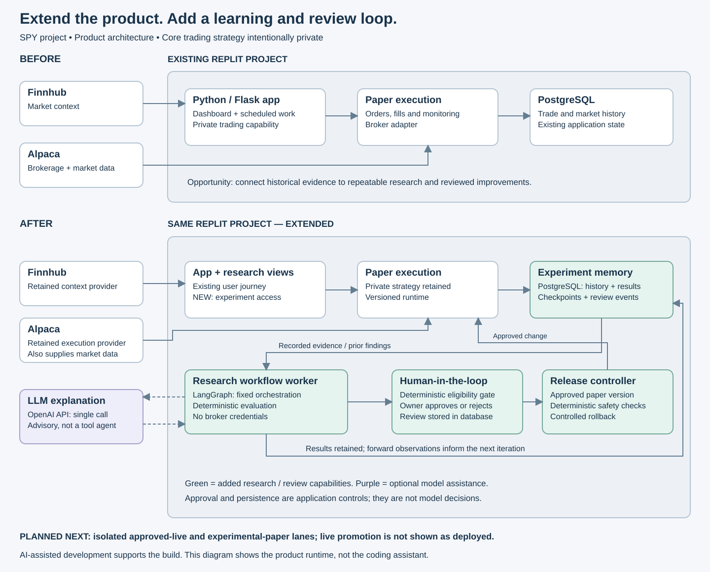
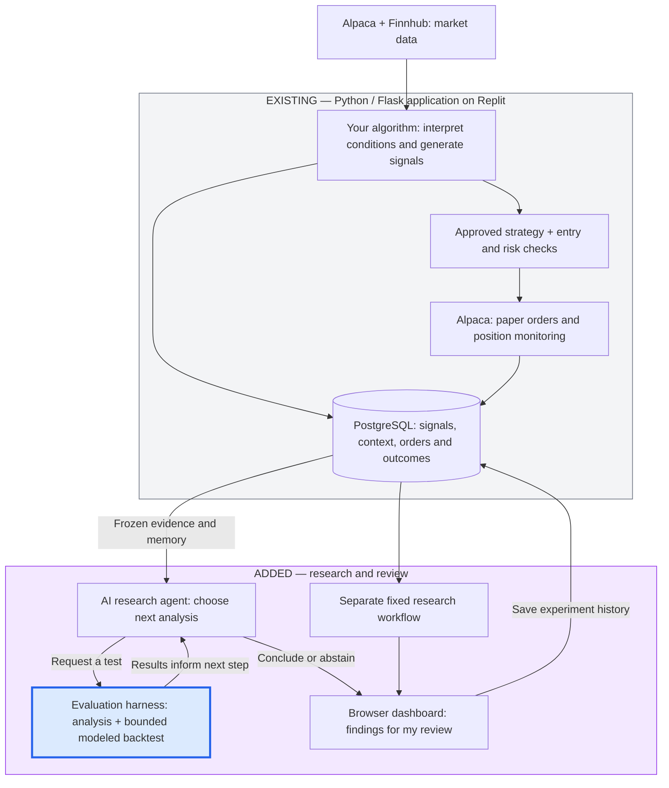
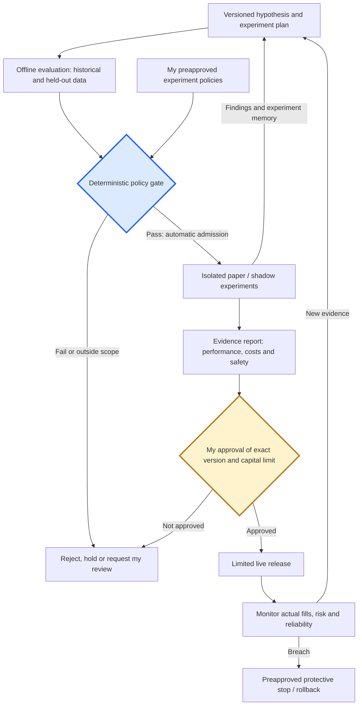
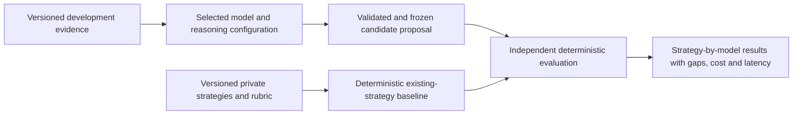

# Architecture: existing foundation, implemented agent, next stage

**Verified November 6, 2026.** The existing Replit application is extended; trading rules remain private.

## Development ownership

Poornima owned product scope, architectural decisions and AI-assisted implementation. Development began in Bolt and moved to Replit for coding and continued development. The migration reason is not asserted here.

## Before: trading automation and fixed research

The existing **Python/Flask dashboard**, **PostgreSQL**, **Alpaca** paper execution and **Finnhub** context remain the foundation. The first research enhancement added a fixed **LangGraph workflow**, deterministic evaluation, experiment memory, optional LLM explanations and human-reviewed paper changes.

*Historical stage: this image shows the fixed workflow before the agent addition below.*

## Now: bounded research agent inside the existing worker

**What is the harness?** The blue box is a logical view of the deterministic evaluation code, not a separate agent or deployment. It supplies approved calculation tools, validates evidence references and explanation scope, runs the fixed-workflow comparison, and records auditable results. The agent runtime chooses tool calls; host code enforces permissions and budgets. The offline test suite exercises these components with controlled cases, while real-model runs test the integration. No public runnable harness code is included in this documentation release.

| AI SDLC component | Responsibility and boundary |
|---|---|
| **Agent runtime** | Model selects follow-up analyses from approved tools based on returned evidence; deterministic code computes results and enforces permissions. A worker is the process hosting it. |
| **Evaluation harness** | Deterministic calculations, evidence checks, baseline comparison and recorded results. The existing comparison establishes control behavior, not equal-task performance superiority. |
| **Experiment memory** | Database records retain findings and rejected questions. This is application memory, not model retraining. |
| **Guardrails and fallback** | Validate tool arguments, evidence references and explanation scope. On errors or exhausted budgets, stop or abstain; interrupted requests are not implicitly repeated. |
| **Observability** | Persist tool traces, usage, source/input hashes and decisions. |
| **Human approval gate** | The agent's output is advisory and ineligible for activation. Separate validation and owner approval are required before any strategy change. |

The current allowlist supports memory inspection, cohort comparisons, bounded filter screening and an explicitly enabled historical-backtest tool. The latter runs the existing ReplayEngine in an isolated child process against one host-selected, hash-verified session. It supports base-cost and higher-slippage modeled sensitivity; executable option-quote replay is rejected for missing timestamp, quote-path and calibration evidence. Synthetic option pricing and excluded unsupported inputs mean this is not a faithful replay of the current paper strategy. The explicit-request agent path does not replace the existing scheduled fixed workflow. The loop uses OpenAI function calling; it is not presented as a new LangGraph agent graph.

Validation: **60 focused checks passed in Replit; real Run #46 called both historical modes and completed with abstention.** Earlier agent runs and failures remain recorded. [Evaluation sheet and limitations](evaluation.md).

## Why Alpaca and Finnhub both appear

**Alpaca answers the execution question:** how to place and observe orders through an API while starting in paper mode. Project history records the owner's explicit choice after discussing paper-testing support. [Alpaca documents separate paper execution and its simulation limitations](https://docs.alpaca.markets/us/docs/paper-trading).

**Finnhub answers the context question:** how to supply market information to the existing analysis. The owner already had a paid subscription and used it in another application. The reviewed adapter supports quotes, options chains, and other contextual endpoints; availability must be checked against the account's actual permissions. This is reuse of an existing provider, not proof of complete historical coverage.

The inspected trading path also uses Alpaca market data. Providers are therefore not interchangeable “primary and backup” copies of identical data. Preserve source, timestamp, coverage, and feed distinctions when comparing results.

## Other components and their limits

- **LangGraph:** explicit orchestration of evidence and evaluation; the graph itself is not proof of autonomous learning. [Official overview](https://docs.langchain.com/oss/python/langgraph/overview).
- **LangSmith:** optional, opt-in trace integration in the research code. It can support observability; enabled end-to-end tracing is not established here. Database run history and dashboard views are the core inspected record.
- **MarketData.app:** an additional adapter in the wider application for supplemental history/fallback requests. Do not imply its paid data access is active or that it resolves every historical options-data gap.
- **Flask, SQLAlchemy, and scheduling code:** reuse the existing web application, database access, and background-work foundation instead of adding separate products for each concern.

## Planned next architecture: isolated experimentation and controlled release

The target AI SDLC below supersedes the earlier target illustration. Automatic paper admission is a proposed capability, not a current agent permission. Current execution supports one active paper strategy and a pending version; concurrent strategy lanes and live promotion are not validated.

- Retain the existing app and bounded research tools; expand historical coverage only after data validation.
- Add a deterministic admission gate that checks my preapproved strategy-change scope, evidence requirements and experiment limits.
- Isolate experimental state, order records, simulated balances and credentials. Paper candidates cannot mutate active-paper or live configuration. If broker paper accounts cannot isolate candidates, use separate simulation/shadow lanes rather than claim account-level isolation.
- Persist candidate, dataset, cost-model and policy versions, admission decisions, traces and evaluation results.
- Require my approval for active-paper replacement, live release and increased live allocation. Test protective stop and rollback behavior before live use.

[Proposed promotion policy](promotion-policy.md). Current integration evidence does not establish live readiness or a productivity advantage.

## Loop, controls and real historical integration

The model is `gpt-4.1-mini-2025-04-14` through OpenAI Responses function calling. The agent loop is custom application code; LangGraph remains the separate fixed evidence/evaluation path. No provider comparison establishes that OpenAI is superior to alternatives.

Each iteration selects one approved tool, validates its arguments, executes it and returns evidence or an error to the next model call. Current ceilings are six model/tool calls, 90 seconds, 50,000 total tokens and $0.05 estimated model cost using configured prices. The final call is reserved for conclusion; errors, resource exhaustion or an interrupted run can stop/abstain earlier. These are per-run limits, not infinite recurrence. A user-facing research cancellation control was not established in this review.

The historical tool restricts requests to a frozen dataset and approved mode, verifies the input hash, and starts an isolated process without database or broker credentials. Its limits include 30 seconds wall time, 20 seconds CPU and one replay session. Interrupted work is not silently retried. Results retain source/input/config hashes, limitations and activation ineligibility.

Run #46 executed memory → modeled base replay → modeled higher-slippage replay → conclusion. Both processed 390 bars and admitted zero trades under synthetic contract assumptions. The model completed in four calls; the result was abstention, not promotion. Executable-quote mode was separately exercised and rejected. No hypothesis confidence score is implemented; sample/effect screens are not calibrated probabilities.

The current database inventory confirms an existing backtesting engine, SPY history, option-chain snapshots and cost settings. The supported adapter validates data timing and accounting behavior with controlled tests; it does not claim empirical calibration of spreads, fills or slippage. Unsupported historical inputs are excluded explicitly. The underlying archive and active trading configuration are preserved.

## Existing algorithmic application: operating cadence and research distinction

The Python/Flask backend hosts the algorithm and background work; the browser dashboard is the client. Market data feeds algorithmic signal generation, approved strategy and entry/risk checks, Alpaca paper orders, position monitoring and stored outcomes. Signal IDs link orders and outcomes; this is traceability, not causal attribution.

Configured signal polling is 45 seconds; paper-position monitoring is 15 seconds. The structural map refreshes on a new day, when the opening range becomes available, and roughly hourly. Outcome tracking runs every five minutes for 15/30/60-minute directional observations. These are configured frequencies, not proof every scheduled job ran on time.

The research dispatcher checks every minute and can enqueue the fixed workflow after 16:20 Eastern on weekdays. That fixed LangGraph path differs from the explicitly requested model-directed agent. The current research features cover selected signal metadata and directional SPY outcomes, not comprehensive trade P&L attribution or historical news/sentiment analysis. Cross-asset displays and calendar descriptions do not establish that every context item is an enforced order gate.

## Target AI SDLC — planned, not deployed end to end

**Orchestration:** the agent proposes and revises hypotheses using tool results and retained experiment state. **Decision engine:** deterministic checks enforce admission policy and compute evidence. **Execution:** isolated paper/shadow workers test admitted candidates while the approved runtime remains unchanged. **Safety:** I approve policies, exceptions and live releases; experimental credentials cannot place live orders. **Observability and evaluation:** versioned inputs, traces, decisions, costs and outcomes support review and reproducibility.

The blue policy gate is a planned extension of the agent's host-side controls; it is not another model. The current agent harness enforces allowed tools and resource limits and records state; the evaluation code computes and checks evidence. The planned experiment/release controls extend this boundary through staging and release.

Agent quality and trading performance require separate evaluation tracks. Model/tool accuracy, safe abstention, latency and cost do not establish strategy profitability. Live decisions require independent strategy evidence, realistic cost assumptions and tested operational controls. Paper outcomes feed research without granting live authority; monitoring may invoke preapproved protective actions, never automatic risk increases.

[Real Run #46 walkthrough](agent-walkthrough.md) · [Evaluation sheet](evaluation.md) · [Roadmap and acceptance evidence](roadmap.md)

## Local evaluation framework — implemented with fixture-only execution

Final evaluation data stays outside proposal iterations. DeepEval custom metrics are integrated locally for fixture evidence contracts, not financial ground truth. Model proposal-generation adapters and real-strategy execution remain unimplemented or blocked; the diagram shows the intended full path. This evaluation pipeline does not grant execution authority. [Specification and model records](strategy-model-benchmarks.md).
