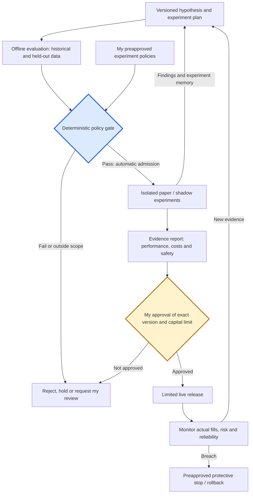

# How a strategy earns more autonomy

**Illustrative product policy. All account amounts and strategy results below are fictional, not recommendations, configured limits, or actual backtest results.** Trading rules remain private.

## The goal

Investigate whether context-aware trading can support supplemental income while limiting capital at risk and time spent supervising. Income is an aspiration, not a required daily outcome: the system must be allowed to do nothing when evidence or conditions are unsuitable.

## Learn without silently changing behavior

Historical observations → contextual comparison → hypothesis → backtest → stored result → next hypothesis. Under the planned policy, candidates that pass historical screening and a deterministic admission gate may enter isolated forward paper evaluation automatically within owner-preapproved scope and limits. The currently approved version stays fixed. Policy exceptions, replacement of the active paper bot, live promotion and live allocation increases require explicit owner approval. Automatic isolated admission is not implemented today.

This is **experiment memory and feedback**, not automatic model retraining. A replay of previously examined history is exploratory; it cannot become fresh evidence merely by rerunning it.

## Example: choose strategy B despite a lower win rate

Compare both candidates on the same held-out dates, starting capital, and sizing policy. In this arithmetic illustration, **1R = $25 of planned risk per trade**. Planned risk is not a guaranteed maximum loss.

| Fictional measure | Strategy A | Strategy B |
|---|---:|---:|
| Win rate | 70% | 55% |
| Average gross win | 0.6R | 1.4R |
| Average gross loss | 1.5R | 1.0R |
| Average round-trip costs | 0.1R | 0.1R |
| Net expectancy per trade | −0.13R | +0.22R |
| Net expectancy in dollars | −$3.25 | +$5.50 |
| Illustrative maximum equity drawdown | 6% | 3% |

**Net expectancy = win rate × average win − loss rate × average loss − costs.**

A's frequent small wins do not cover its losses and costs. Reject it at this screen. B earns further evaluation: it has positive arithmetic expectancy and a smaller assumed drawdown. Neither the averages nor the drawdown figures establish uncertainty, robustness, or future income. B has not earned live promotion from this table alone.

## Example risk budget

For a fictional **$10,000 evaluation allocation**, use $25 planned risk per trade, a $100 daily loss stop, a $300 calendar-month loss stop, and a $500 peak-to-trough portfolio drawdown stop. These are policy examples, not inferred user preferences.

Daily/monthly stops use total marked-to-market equity, including unrealized P&L and costs, relative to the start of the period, adjusted for deposits and withdrawals. Portfolio drawdown uses the cash-flow-adjusted high-water mark across all live strategies. Paper P&L does not count toward live equity. Stop thresholds trigger controls; gaps and execution delays can still cause overshoot.

Crossing any limit blocks new entries, cancels pending entry orders, and triggers review. Existing positions follow a preapproved risk-reduction procedure; a stop must not abandon position supervision. A daily reset must not clear a monthly or portfolio lock. These controls require implementation and testing before use.

## Promotion gates and time in testing

| Stage | Evidence required | Decision |
|---|---|---|
| **Historical screen** | Frozen candidate; versioned inputs; time-ordered development and evaluation; no future information; realistic options data, costs, and stress scenarios | Reject weak candidates before spending market sessions on them. An underlying-price proxy cannot establish options profitability. |
| **Confirmatory backtest** | Untouched period after candidate selection; positive net expectancy with uncertainty assessed across sessions; drawdown inside the example budget under base and stressed costs; comparison to an equal-risk baseline | Automatically admit to isolated paper only if the complete evidence and preapproved policy pass; otherwise hold for review. Previously mined dates do not qualify as untouched. |
| **Forward paper / shadow** | Example first review after at least 20 new sessions and 30 attributable closed trades per arm; complete records for the evaluated cohort; no unresolved critical control failures; performance remains inside the risk budget | This is a review floor, not proof of reliability. Sparse or correlated observations can require more evidence. |
| **Limited live trial** | Prior gates pass; execution-cost assumptions documented; tested limits and account isolation; explicit owner approval of the exact version and capital cap | Measure actual fills and execution behavior at a separately approved, limited exposure. No automatic deployment. |
| **Scale, hold, or stop** | Actual costs and drawdown remain within approved limits; sufficient new evidence; owner review | Scale only by another approval. Stop on a hard-risk breach; return to research when the hypothesis fails. |

For this example, preregister the evaluation window and uncertainty method before the run. Use a session-aware confidence interval for net expectancy; require its lower bound above zero under the specified cost model. Also report regime coverage and tail losses. A sample minimum cannot substitute for this analysis, and searching many candidates requires a fresh final holdout or a multiple-testing adjustment.

Report win rate and sample count by day and month, and net expectancy and maximum marked-to-market drawdown for each strategy and the combined live portfolio. Break-even and unresolved trades must have explicit treatment. Daily win rates with very few trades are descriptive, not reliable promotion criteria.

Do not promote because “two weeks passed” or “win rate reached 60%.” Inspect operations continuously, but make performance decisions at predefined checkpoints. At the first review, either pass, reject, or identify the specific missing evidence. If extending, set a new endpoint and a valid sequential-testing plan or a fresh confirmatory block; repeated peeking must not manufacture confidence. If the missing data cannot be obtained, park the candidate instead of waiting through uninformative sessions.

## Parallel testing and production — proposed design

Paper candidates cannot write live configuration or send orders through live credentials. Compare versions using the same opportunity universe, accounting for different trade coverage, exposure, and costs. A new candidate does not replace a live version solely because its paper win rate is higher.

## Evidence status

The repository contains historical exploratory replays and paper-review logic. A private inventory and historical diagnostic comparisons are complete; they do not establish options profitability or live eligibility. The bounded research agent now invokes the existing historical engine in a restricted, synthetic-options sensitivity mode, documented in [the evaluation sheet](evaluation.md). Real Run #46 abstained after zero-trade replays. This is not a live-promotion gate or realistic executable-options validation. No actual backtest numbers are presented here as the fictional A/B example. Live eligibility remains unestablished; proposed gates above are not claimed to be deployed.

Sources: [Alpaca's simulation limitations](https://docs.alpaca.markets/us/docs/paper-trading); [Investor.gov on hypothetical performance and performance claims](https://www.investor.gov/introduction-investing/general-resources/news-alerts/alerts-bulletins/investor-bulletins-47).
