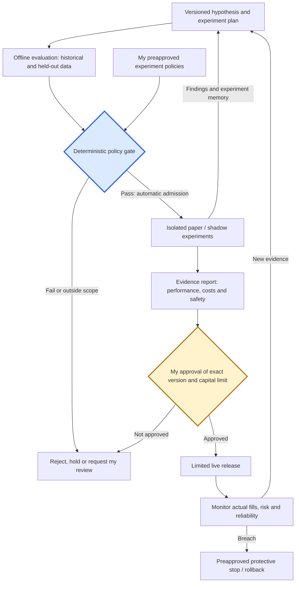

# Roadmap: controlled experimentation through the AI SDLC

**Planned architecture · Updated November 7, 2026 · Not runtime authorization**

## Why this is next

**Product decision: automate isolated learning under my approved policies; retain human approval for real-capital changes.** This addresses the gap between investigating a hypothesis and collecting new evidence without manually supervising every experiment.

The agent may propose a versioned candidate and request paper testing. A **deterministic policy gate**, not the model's judgment alone, would admit it automatically only within my preapproved scope: allowed strategy templates and changes, required historical evidence, data quality, duration, compute and simulated-risk limits. Anything outside that scope returns to me for review.

This parallels the **AI software development lifecycle (AI SDLC)**: versioned proposal → offline evals → isolated staging → human release approval → monitored release → feedback. Learning means retaining evidence and revising hypotheses; it does not mean automatic model retraining or permission to deploy.

| Capability | Status |
|---|---|
| Algorithmic app with paper execution; separate fixed after-market research workflow | **Implemented** |
| Explicitly requested bounded agent, experiment memory, tool traces and one-session modeled historical replay | **Implemented**; Run #46 abstained after zero-trade replays |
| One active paper strategy with a pending-version review/approval path | **Implemented**; research output cannot activate a strategy |
| Automatic admission to isolated paper experiments under my policies; multiple independent candidates | **Planned** |
| Recurring agent review, broader historical validation and end-to-end experiment feedback | **Planned** |
| Human-approved live release, parallel paper/live lanes and tested release/rollback controls | **Planned** |

**Human control:** I approve the experimentation policy, exceptions, replacement of the active paper bot, each exact version entering live trading, and any increase in live allocation. Within policy, individual isolated experiments would not require another approval. Experimental lanes cannot change the active bot or access live credentials. Multiple live strategies would also need combined portfolio-risk controls.

**Two evaluation tracks:** agent evals check tool choice, evidence accuracy, safe abstention, reliability and cost; strategy evals check independent performance evidence, execution assumptions, drawdown and operational safety. Passing agent evals does not qualify a strategy for live trading. Paper results also cannot establish actual live fills or slippage.

**This end-to-end process is planned, not deployed.** Promotion depends on evidence quality and predefined risk/operational gates, not merely win rate or days elapsed. The agent can request a live review; it cannot approve it.

Next work: broader point-in-time options evaluation, isolated experiment infrastructure, verified news/sentiment inputs if useful, complete trade-outcome attribution, and matched-task evaluation against a capable fixed workflow. A signal's heuristic score is not a calibrated probability that its trade will win.

**Usefulness comes first:** measure my review effort, corrections and time to an evidence-backed decision. A sanitized walkthrough and documented evaluation fixtures will make that evidence inspectable without distributing the trading strategy.

## Implementation sequence and acceptance evidence

| Next step | Problem it solves | Evidence required before advancement |
|---|---|---|
| Expand historical evaluation | One modeled session cannot support strategy selection | Versioned, point-in-time datasets; validated quote paths and cost assumptions; independent evaluation windows |
| Build isolated experimental lanes and policy admission | Manual supervision limits experimentation; shared state can contaminate results | Tests for allowed/denied requests, credential and state isolation, experiment limits, and preservation of the active bot |
| Enable recurring research and feedback | Findings need to inform subsequent experiments | Scheduled-run traces, complete outcome attribution, retained candidate/evidence versions and bounded recovery behavior |
| Compare agent with a capable fixed workflow | Adaptive reasoning adds complexity and cost | Matched tasks, repeated trials, evidence-quality scores, review effort, latency and total cost |
| Add a controlled live-release path | Paper results cannot establish live execution quality | Exact-version approval, allocation limits, tested protective actions and rollback; subsequent actual-fill monitoring |

A sanitized demo, short video, documented evaluation fixtures and structured owner feedback accompany these milestones. Initial usefulness is measured in my own workflow; broader adoption follows controlled live validation and the requirements for broader use.

[Case study](README.md) · [Architecture](architecture.md) · [Evaluation evidence](evaluation.md) · [Illustrative promotion criteria](promotion-policy.md)

## Framework milestone verified — November 7, 2026

The local registry, bounded proposal validator, deterministic metrics, evaluation-data gates, reports and offline DeepEval integration are implemented. Current-version financial baselines remain blocked. Next establish version-linked full opportunity/quote/fill/cost/equity evidence and validate a production-equivalent replay adapter. Then connect provider-generated proposals and run independent comparisons. Other-provider runs, automatic paper admission and live promotion remain future work. [Verified status and missing results](strategy-model-benchmarks.md).
