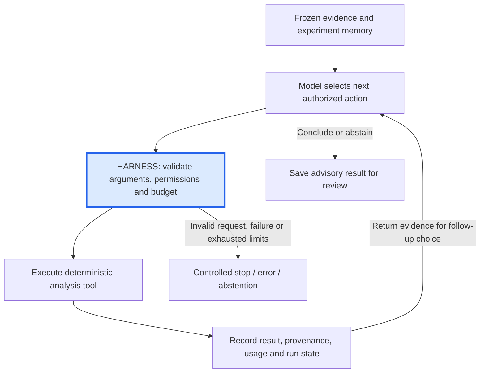

# How the research agent works: real Run #46

**Implemented integration · Observed in Replit November 6, 2026 · Strategy details withheld**

This is a recorded run, not a fictional winning-trade example. It demonstrates how the agent uses tools and stops when the evidence cannot support a performance conclusion.

## The task and available evidence

The explicitly requested agent could inspect experiment memory and invoke an authorized historical-backtest tool. The tool permitted one frozen historical session with modeled option pricing and host-defined cost modes. It did not permit arbitrary strategy code, cost assumptions or live orders.

## The observed sequence

| Step | Agent action | Evidence returned / implication |
|---|---|---|
| 1 | Read experiment memory | Prior research context was available for the investigation. This is database memory, not model retraining. |
| 2 | Request the base-cost historical replay | The engine processed 390 bars and admitted zero trades under the synthetic contract assumptions. |
| 3 | Choose the higher-slippage replay as the next analysis | The engine again processed 390 bars and admitted zero trades. This exercised another permitted mode but supplied no executed-trade comparison. |
| 4 | Conclude with abstention | There was no trade sample from which to infer expectancy, drawdown or a strategy improvement. No activation followed. |

The trace establishes the sequence of tool choices. It does not prove the higher-slippage run was the most useful follow-up: with no admitted trades, it added little performance evidence. That is a concrete question for future agent-quality evaluations.

## The loop and the harness

The host checks evidence references and conclusion scope; it does not accept model-written numbers as measurements. The model can choose among permitted analyses, but cannot invent executable tools or rewrite trading rules.

**Limits:** at most six model/tool calls, 90 seconds, 50,000 total tokens and $0.05 estimated model cost using configured prices. The final call is reserved for conclusion. The historical subprocess has additional limits, including a 30-second wall-time ceiling. Failures may stop a run earlier; interrupted work is not automatically repeated.

Run #46 completed in **four model calls**, using **6,902 tokens**, with a recorded model-cost estimate of **$0.0028892**. This excludes hosting, data and human effort and is not a general cost benchmark.

## Human involvement and interpretation

Today a person explicitly requests this agent path and reviews the advisory result. The agent cannot approve or activate strategies. A dedicated user-facing cancellation control was not established in the review; system-enforced limits bound the run.

**Verified:** real model-to-tool execution, both replay modes, retained evidence and abstention. **Not established:** realistic options profitability, calibrated hypothesis confidence, an optimal investigation path or live readiness. The zero-trade result concerns the declared synthetic assumptions, not whether actual listed contracts were tradable.

The planned extension is automatic admission to isolated paper experiments under preapproved policies, followed by human approval for any live release. That permission is not present in this run.

[Evaluation sheet](evaluation.md) · [Architecture](architecture.md) · [Planned AI SDLC](roadmap.md) · [Case study](README.md)
